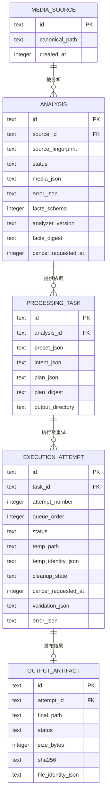

# P1 数据库设计 / user_version 2

Worker 是唯一写入者，Flutter 通过 HTTP/SSE 获取投影，Host/FLL 不访问数据库。使用独立的 framelean-v2.sqlite3，保留归档数据库。SQLite 开启 WAL、外键，迁移采用 user_version 和事务。

## 关系与约束

来源 S1 经分析 A1，任务 T1 引用 A1；取消的 E1 和成功的 E2 都引用 T1，结果 O1 引用 E2。外键约束记录必须有真实父记录，默认限制删除。路径不是唯一身份，分析指纹是当时文件身份、大小、修改时间和首尾各 1 MiB 摘要的不可变快照。参数和媒体细节保存为 JSON，关系、顺序、状态使用明确列。

任务与尝试编号联合唯一；每个尝试最多一个输出；同任务最多一个 queued/running/validating/publishing/reconciling 尝试。task 状态从最新 attempt 推导。request_receipts 保存请求与接受结果，worker_state 保存暂停状态、顺序及持久 revision；SSE 序号另在会话内递增。

## 三条流程

正常：来源与分析落库 → 分析成功 → 任务及第一次尝试事务入队 → 执行与校验 → 记录发布意图 → 硬链接发布 → 成功落库 → 清理临时名称。

取消重试：取消意图先落库；等待项直接取消，运行项协作取消，3 秒后强杀 Host；清理临时文件。同任务新增尝试、编号递增、排队尾，历史不覆盖。publishing/reconciling 阶段拒绝取消，完成发布对账。

崩溃恢复：运行分析和执行按已持久化的取消意图标记 canceled 或 interrupted，等待队列保留且暂停。publishing 正式文件身份、大小和哈希匹配则补记成功；可访问目录中的文件缺失则中断；目录不可访问保留 reconciling，可显式重新核对；不匹配则保留文件、记录冲突。仅清理名称和文件身份均符合登记的临时文件。cleanup_state 独立保存 pending/done/error，清理失败保留成功结果。文件核验与清理在事务外执行。

## 归档经验

archive/alpha/v1.3.0 的客户端 tasks 表混合分析、配置、运行与输出；本次拆分实体。work_queue.rs 的 revision 体现后台顺序权威；本次使用 FIFO。snapshot_store.rs 与 worker_process.rs 证明分析快照重启恢复，不替代执行发布恢复测试。260607-drift-migration-safe-add-column.md 记录重复加列问题；新库迁移须事务化并验证实际结构，不能吞掉任意迁移错误。

## 生命周期

重启默认暂停，用户显式继续。关闭 UI 不改变队列；正式退出取消当前操作、保留等待项并暂停。进度仅存在内存，关键状态先落库后广播。输出哈希仅用于恢复对账，不将源文件大小/修改时间宣称为密码学完整性证明。

## v1 → v2 迁移

迁移前通过 SQLite backup API 保存一致性 `.v1-<id>.backup`，再事务化添加计划、取消、校验、文件身份和清理字段，重建 execution_attempt 状态约束及索引。提交前核对表、列、外键和索引定义，检查 foreign_key_check；失败回滚并保留原数据。重复打开 v2 不重复执行 ALTER。

旧记录和输出保留；旧 queued 执行标记 interrupted / plan_required，旧任务缺少新方案时要求重新分析、创建任务。旧活动执行按恢复规则处理；身份缺失的旧临时文件保留供人工核对。不会导入归档分支数据库。

数据库当前字段和约束见 `fengine/src/schema_v1.sql` 与 `migration_v2.sql`，真实旧行升级、唯一活动执行和回滚测试位于 `repository.rs`。任务计划提交后不修改，重试沿用同一计划；更改配置创建新任务。

## P2 计划升级

SQLite 保持 user_version 2 和上述关系；新的事实版本 2、执行计划版本 2 保存到现有 JSON 字段。计划增加目标容器与扩展名、`remux / transcode` 参数及实际效果。启动时将缺少当前计划版本的旧等待执行标记 `interrupted / plan_required`，保留原任务、参数和历史，用户重新分析并创建任务。重试只接受原方案完整复核通过的记录。

旧 publishing 结果先按已登记的路径、文件身份、大小及哈希对账，完成记录及输出持续可查。临时清理从登记名称和文件身份确认归属，适用于 MP4 和 MKV。真实 v3 数据目录升级结果见 [本轮验收](p2-validation.md)。

## 持久化与故障边界

WAL、foreign_keys=ON、synchronous=FULL；数据库由协调器线程独占写入。状态回执提交后再推送事件；progress 不落库。发布顺序为临时文件校验/哈希 → 发布意图事务 → 同卷无覆盖硬链接 → 成功事务 → 临时名称清理。取消和发布进入同一协调器，发布事务是竞争裁决点。

macOS 使用文件 fsync 和目录同步；Windows 保留文件同步及 SQLite FULL，同步目录的等价行为尚待 Windows 实测。当前故障测试证明进程中断恢复，未等同于实际断电或物理拔盘验收。
